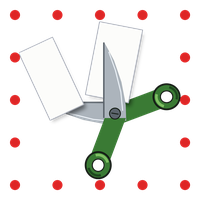
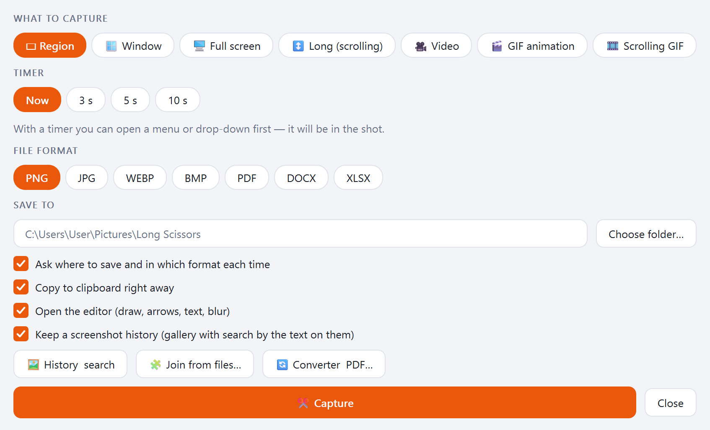
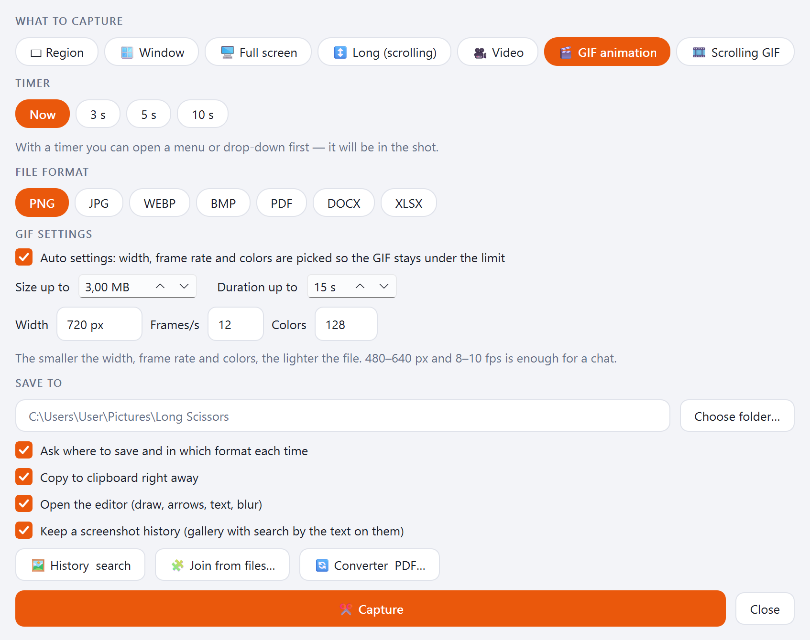
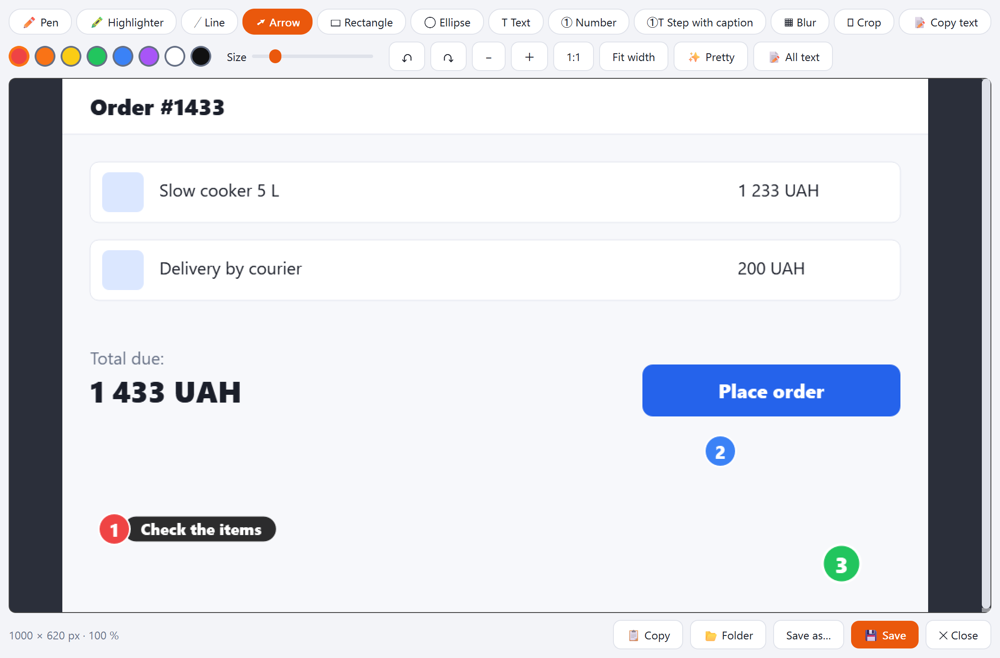
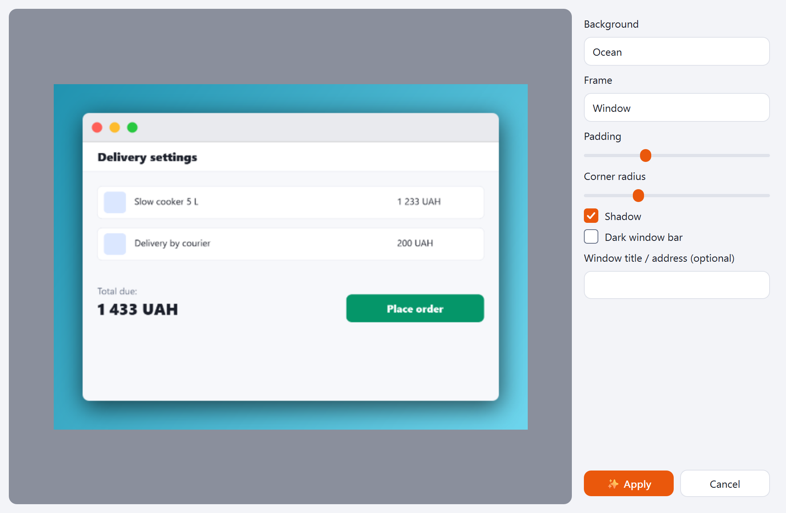
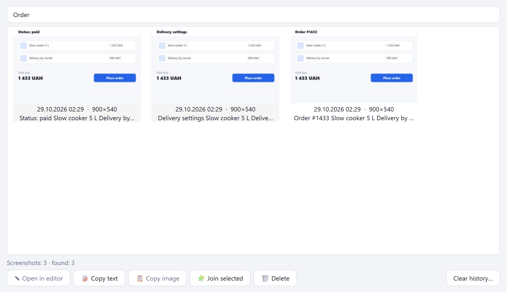
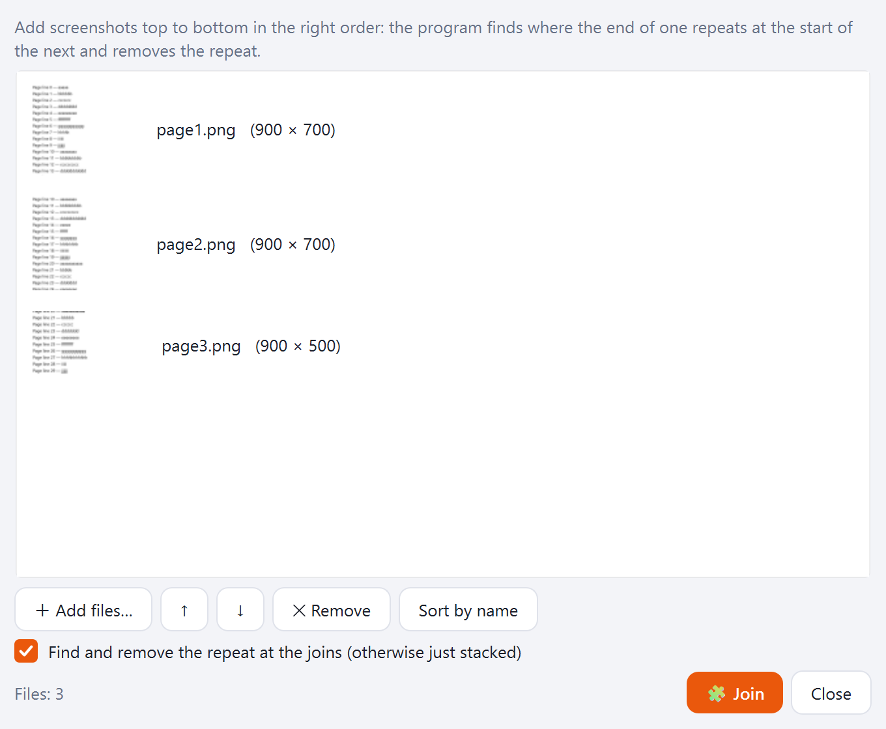
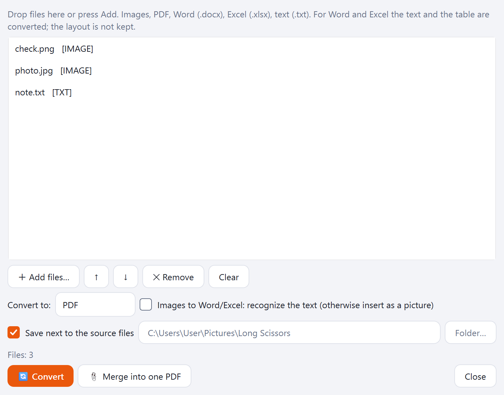
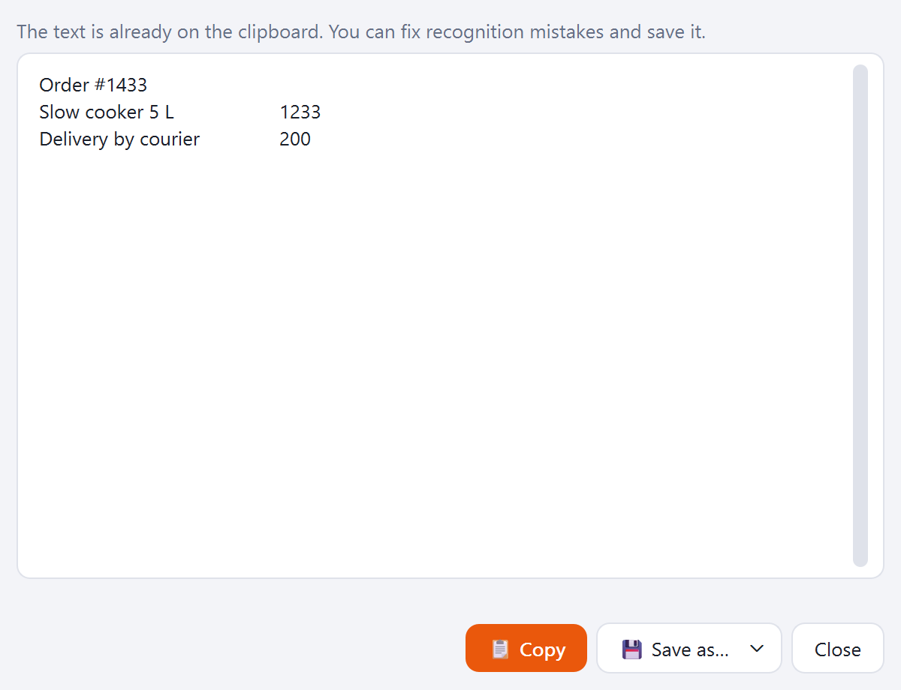
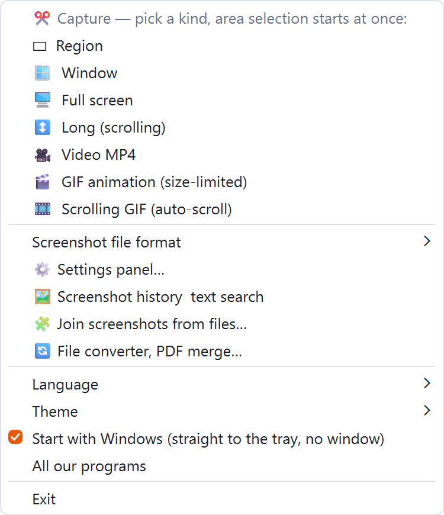

[English](README.md) · [Українська](README.uk.md) · [Русский](README.ru.md)

🌐 All our programs: https://drugoj00.github.io/

Description and screenshots: https://drugoj00.github.io/phone-in-window-with-sound/long-scissors.html

# Long Scissors

Windows screenshots: area, window, screen and a long scrolling page; video and GIF recording; editor, text from a shot, searchable history.

A free Windows program. Captures an area, a window, the whole screen and a long page: the page scrolls down automatically and the frames are stitched without repeats. Records video with sound and GIFs with a size limit. Editor with drawing, steps and blur, “Pretty” for a frame and background, copy text from a shot (OCR), history with text search, joining and converting files. Lives in the tray: a click on the icon starts a capture at once.

⭐ If the program is useful, please star this repository: it costs nothing and helps other people find it.

## Download

**Version 2.0.** [LongScissors-2.0.exe](https://github.com/drugoj00/long-scissors/releases/latest) (Assets) · [Releases](https://github.com/drugoj00/long-scissors/releases)

SHA-256: `b8097bee020ab5183ac1d307c17e77376dd0fc895d50f2b75f2b4f4cddd02b4f`

## What's new in 2.0

- The installer is smaller
- Long screenshot: more reliable scrolling in browsers (Opera, Chrome, Edge): an area with tabs, the address bar and a side panel is stitched correctly, the wheel, arrow keys and PageDown are chosen automatically, and if the page does not scroll the program says so
- The result of a screenshot opens right away in a normal window, as in Windows Snipping Tool: the capture bar closes itself and the editor comes to the front
- The “Save” and “Copy” buttons visibly react to a click (“✓ Saved”, “✓ Copied”) and are protected from double clicks
- A corner notification “Saved”: file name and folder, buttons “Open file” and “Show in folder”; “Not saved” with the reason on failure; the same for “Copied to clipboard”
- Saving the same screenshot again no longer creates a second file: “Already saved” is shown with the name and folder; the file name carries the moment of the shot, and _2 is added on a name clash
- Update check: a “Version X is out” notification once a day and a “Check for updates” item in the tray menu; the “Download and install” button fetches the installer from the GitHub release, checks the file by SHA-256 (the install is cancelled on a mismatch) and restarts the program

## Features

### Screenshots

- Area, window, whole screen and a long shot: scrolls down automatically and stitches frames without repeats.
- Timer up to 10 s to open a menu or a list.
- PNG, JPG, WEBP, BMP, PDF, Word, Excel; copy to the clipboard.
- A click on the tray icon starts a capture at once; middle click picks the format; Ctrl+Shift+S opens the panel.

### Video and GIF

- MP4 video with sound: system, microphone or both, device choice.
- GIF with a size and duration limit, width, frame rate and colors picked automatically.
- Scrolling GIF: the page scrolls automatically.

### Editor

- Pen, highlighter, line, arrow, rectangle, ellipse, text, numbers, steps with a caption, blur, crop.
- “Pretty”: window or phone frame, shadow, background.
- Copy text from a shot (Windows OCR); tables go to Word and Excel.

### Files and history

- Shot history with search by the text on the shots.
- Join a long shot from ready images or PDFs.
- Converter: images, PDF, Word, Excel, text; merge files into one PDF.

### Everything else

- Tray icon, autostart without a window, a single running copy.
- Russian, Ukrainian, English; light and dark theme.

## Screenshots

## Requirements

Windows 10 or 11 (64-bit). Administrator rights are optional. Copying text uses Windows recognition; if the needed language pack is missing, the program offers to download it (internet and administrator rights are needed).

## Quick start

1. Download LongScissors-2.0.exe and run it; Windows asks for permission (if declined, the program goes into your user folder).
2. The program lives in the tray by the clock: click the icon to select an area at once; right click for all modes, format, language, theme.
3. Ctrl+Shift+S opens the panel with settings: what to capture, timer, format, folder.
4. The shot opens in the editor: draw, copy, save.

## Limits

- A long shot scrolls the page with the mouse wheel and moves the cursor: better not to use the mouse while it runs.
- A window running as administrator cannot be scrolled by the program (Windows protection): in that case it says so.
- Copying text relies on Windows recognition: Ukrainian “і”, “ї”, “є” are sometimes lost.
- System and microphone sound are recorded separately and aligned by the clock; a small shift is possible.
- Tested on Windows 11; screen and sound recording was not tested separately on Windows 10.
- The installer is not signed with a publisher certificate: Windows may show a SmartScreen warning (“More info” → “Run anyway”).
- ffmpeg is inside, LGPL/GPL.
