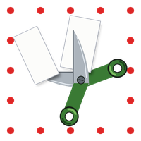
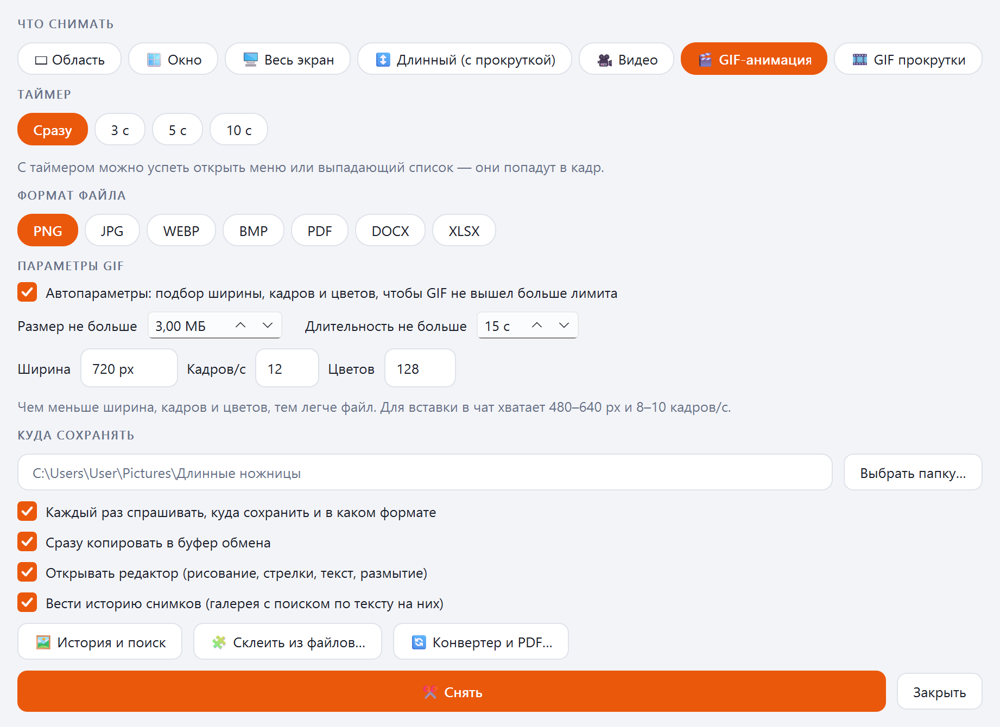
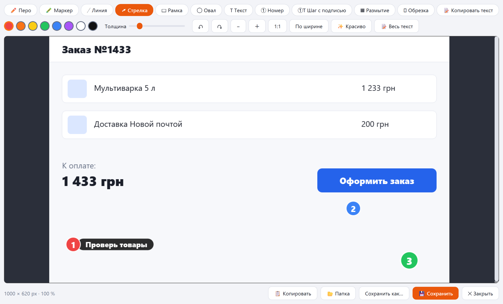
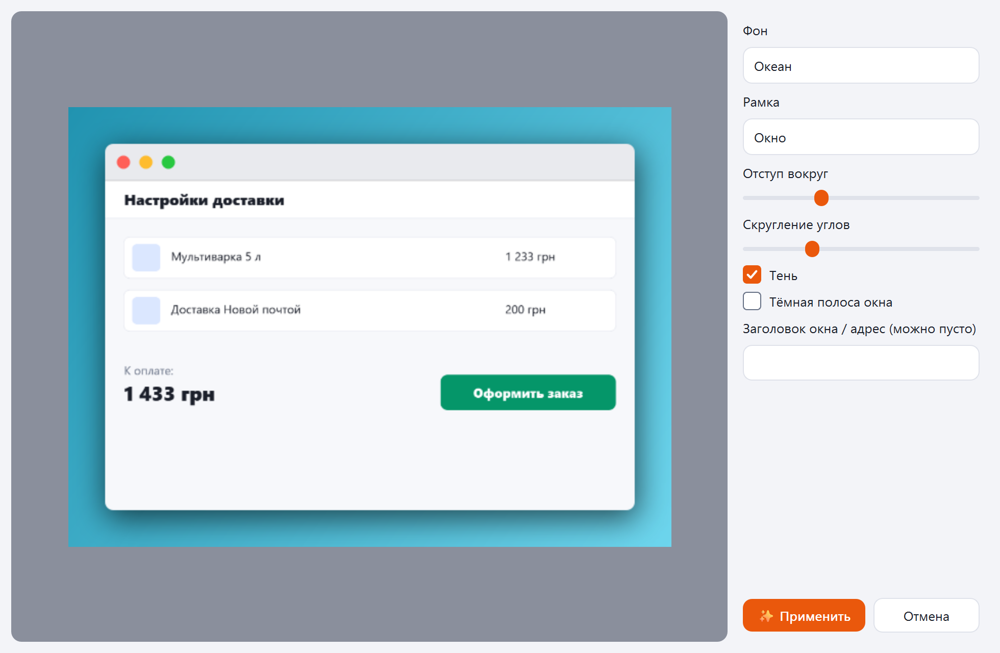
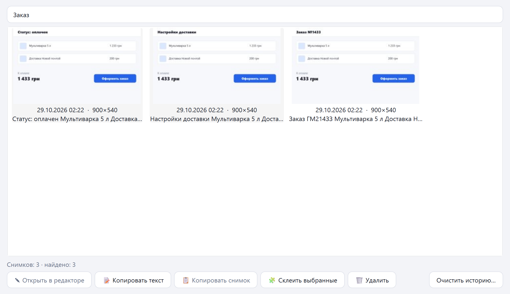
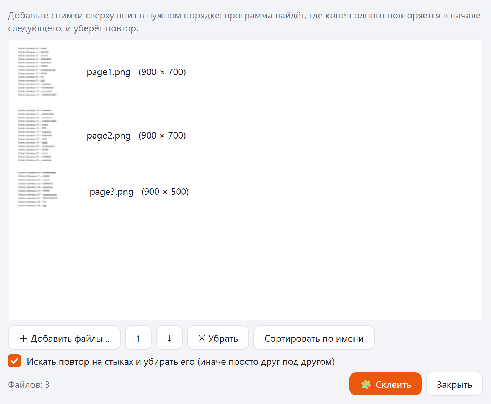
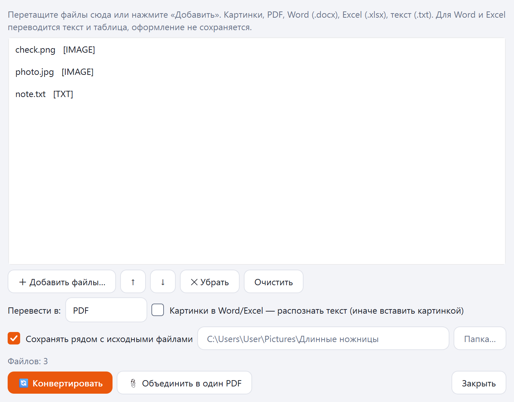
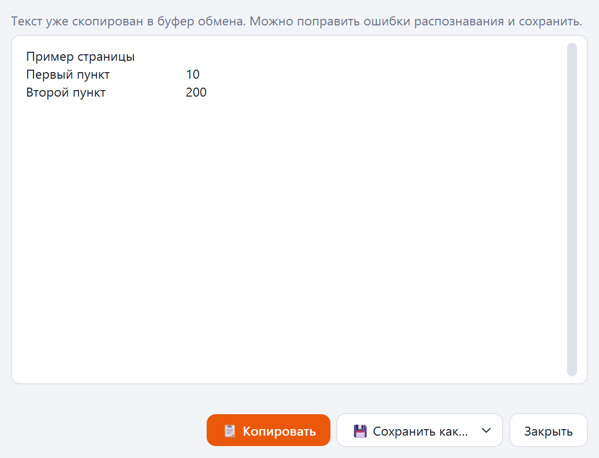
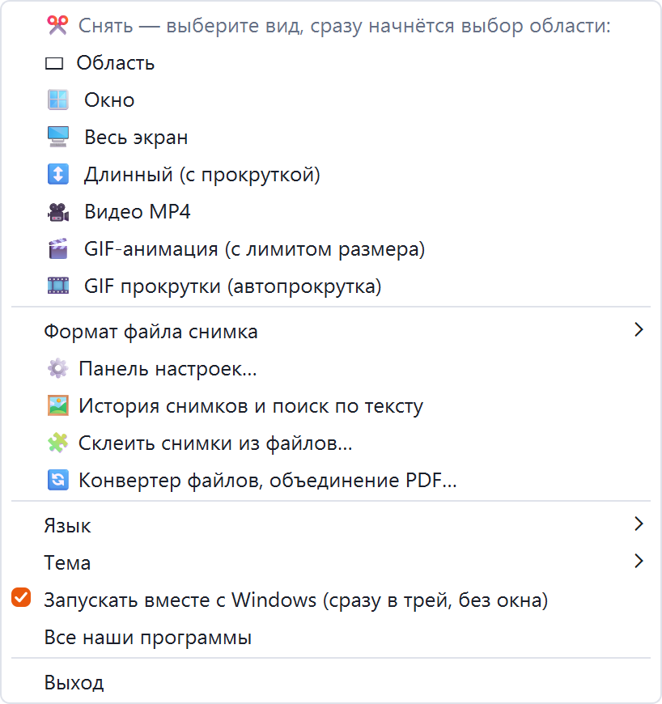

[English](README.md) · [Українська](README.uk.md) · [Русский](README.ru.md)

🌐 Все наши программы: https://drugoj00.github.io/

Описание и скриншоты: https://drugoj00.github.io/phone-in-window-with-sound/long-scissors.html

# Длинные ножницы

Скриншоты Windows: область, окно, экран и длинная страница с прокруткой; запись видео и GIF; редактор, текст со снимка, история с поиском.

Бесплатная программа для Windows. Снимает область, окно, весь экран и длинную страницу: страница листается вниз автоматически, кадры склеиваются без повторов. Пишет видео со звуком и GIF с лимитом размера. Редактор с рисованием, шагами и размытием, «Красиво» для рамки и фона, копирование текста со снимка (OCR), история с поиском по тексту, склейка и конвертер файлов. Живёт в трее: щелчок по значку сразу начинает съёмку.

⭐ Если программа полезна, поставьте звезду этому репозиторию: это бесплатно и помогает другим её найти.

## Скачать

**Версия 1.0.** [LongScissors-1.0.exe](https://github.com/drugoj00/long-scissors/releases/latest) (Assets) · [Releases](https://github.com/drugoj00/long-scissors/releases)

SHA-256: `153688d37dfc5728e6ebb0f3113bcedf377e05f126a9a2dafd5afddbb7cff41d`

## Что нового в 1.0

- Первая публичная версия: всё перечисленное выше.

## Возможности

### Снимки

- Область, окно, весь экран и длинный снимок: автопрокрутка вниз и склейка кадров без повторов.
- Таймер до 10 с, чтобы успеть открыть меню или список.
- Форматы PNG, JPG, WEBP, BMP, PDF, Word, Excel; копия в буфер обмена.
- Щелчок по значку в трее сразу начинает съёмку; средняя кнопка — выбор формата; Ctrl+Shift+S открывает панель.

### Видео и GIF

- Запись видео MP4 со звуком: система, микрофон или оба канала, выбор устройства.
- GIF с лимитом размера и длительности, подбор ширины, кадров и цветов.
- GIF прокрутки: страница листается автоматически.

### Редактор

- Перо, маркер, линия, стрелка, рамка, овал, текст, номера, шаги с подписью, размытие, обрезка.
- «Красиво»: рамка окна или телефона, тень, фон.
- Копирование текста со снимка (OCR Windows), таблицы — в Word и Excel.

### Файлы и история

- История снимков с поиском по тексту на них.
- Склейка длинного снимка из готовых картинок или PDF.
- Конвертер: картинки, PDF, Word, Excel, текст; объединение файлов в один PDF.

### Остальное

- Значок у часов, автозапуск без окна, одна копия программы.
- Русский, украинский, английский; светлая и тёмная тема.

## Скриншоты

## Требования

Windows 10 или 11 (64-бит). Права администратора не обязательны. Копирование текста использует распознавание Windows (русский язык должен быть установлен); интернет не нужен.

## Быстрый старт

1. Скачайте LongScissors-1.0.exe и запустите; Windows спросит разрешение (при отказе программа встанет в папку пользователя).
2. Программа живёт в трее у часов: щелчок по значку — сразу выбор области; правая кнопка — все режимы, формат, язык, тема.
3. Ctrl+Shift+S открывает панель с настройками: что снимать, таймер, формат, папка.
4. Снимок открывается в редакторе: рисуйте, копируйте, сохраняйте.

## Ограничения

- Длинный снимок листает страницу колёсиком мыши и двигает курсор: во время съёмки мышью лучше не пользоваться.
- Копирование текста опирается на распознавание Windows: украинские «і», «ї», «є» иногда теряются.
- Запись звука системы и микрофона идёт отдельно и совмещается по часам; небольшой сдвиг возможен.
- Проверено на Windows 11; на Windows 10 запись экрана и звука отдельно не проверялась.
- Установщик не подписан сертификатом издателя: Windows может показать предупреждение SmartScreen («Подробнее» → «Всё равно выполнить»).
- Внутри ffmpeg, лицензия LGPL/GPL.
