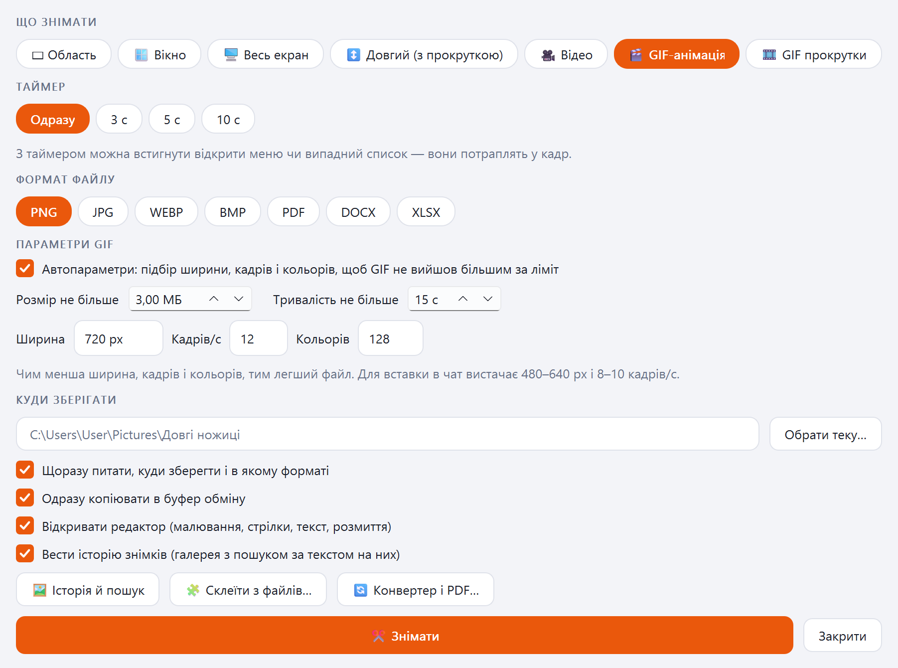
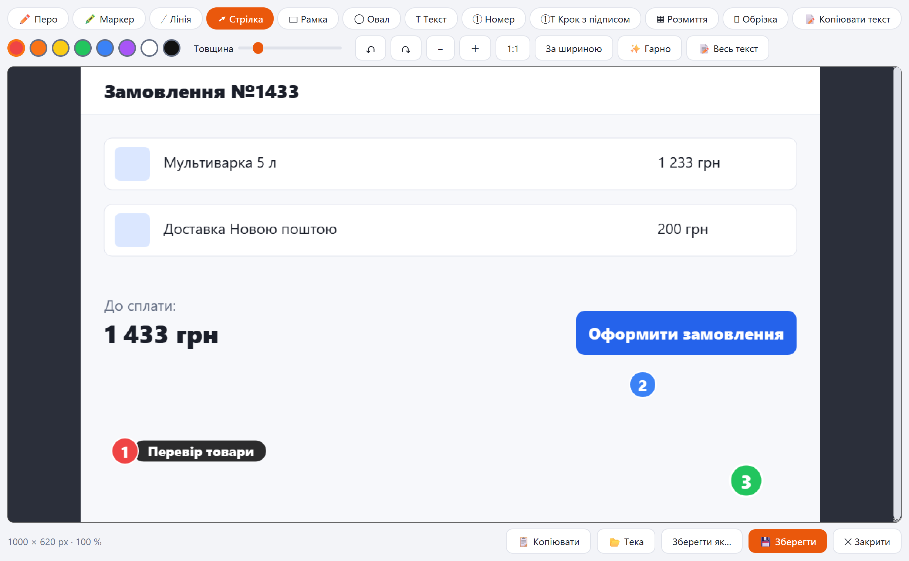
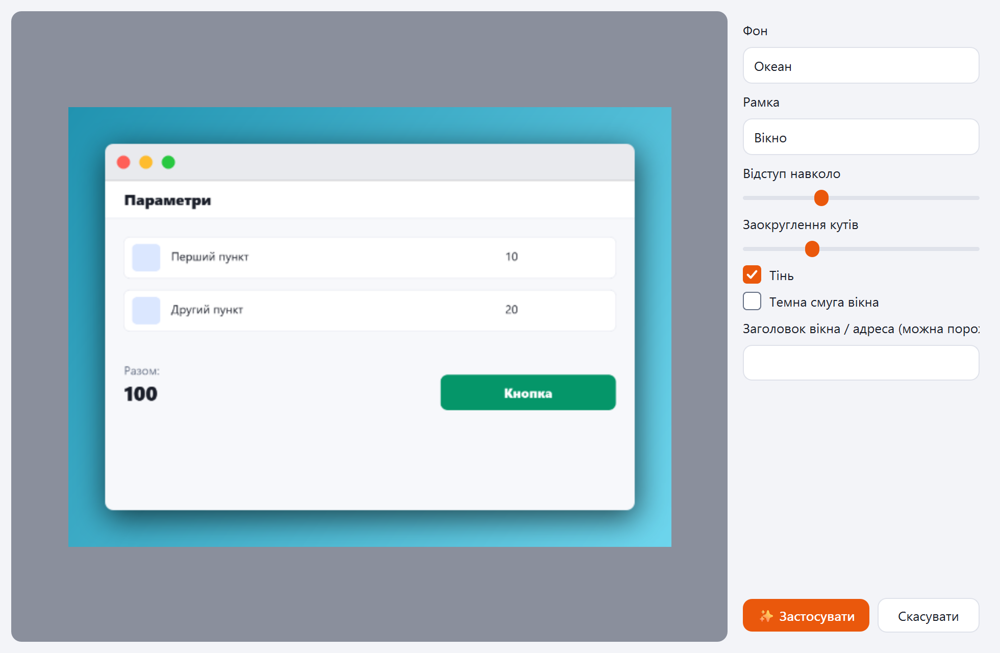
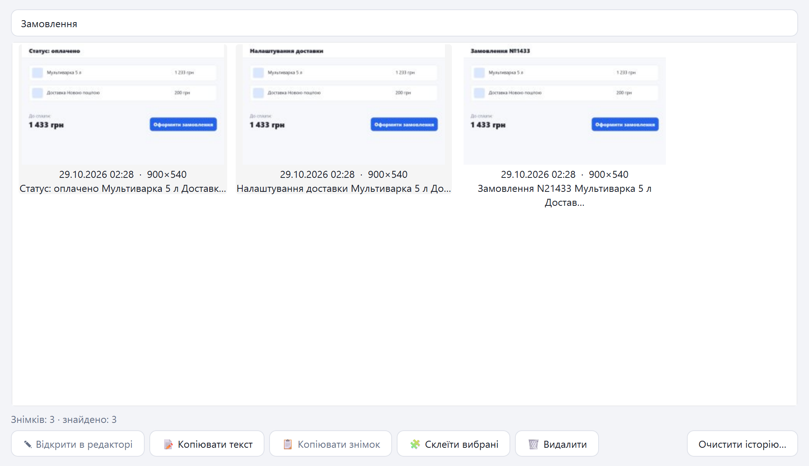
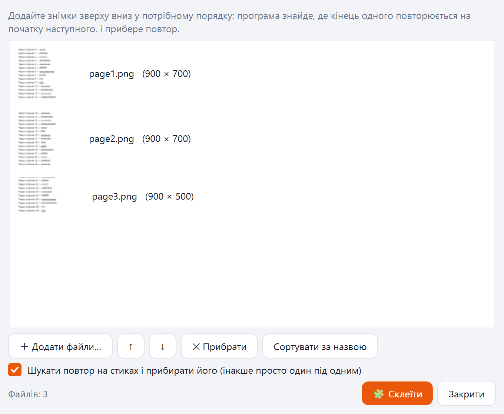
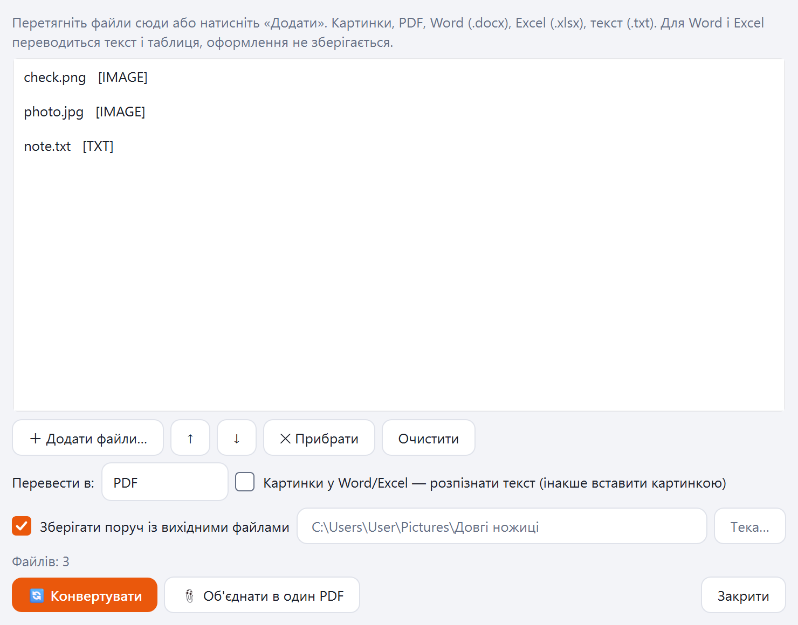
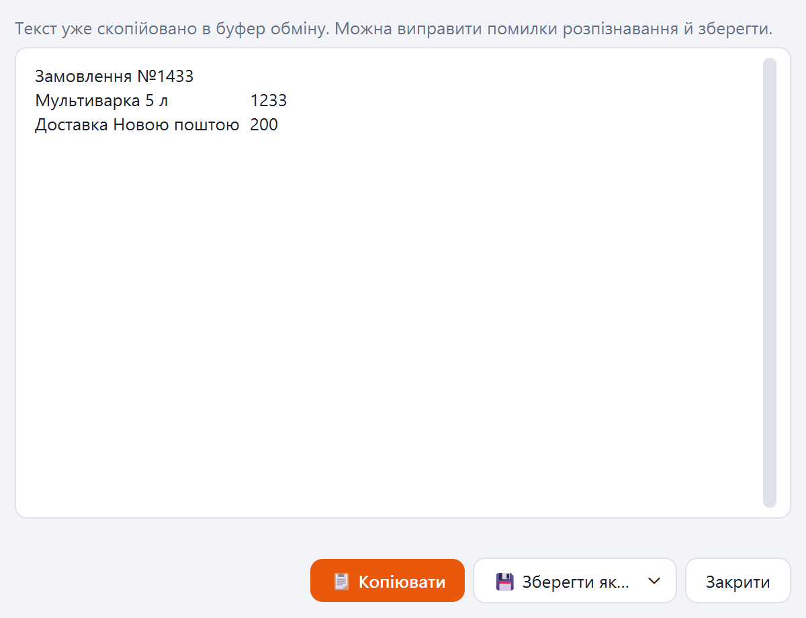
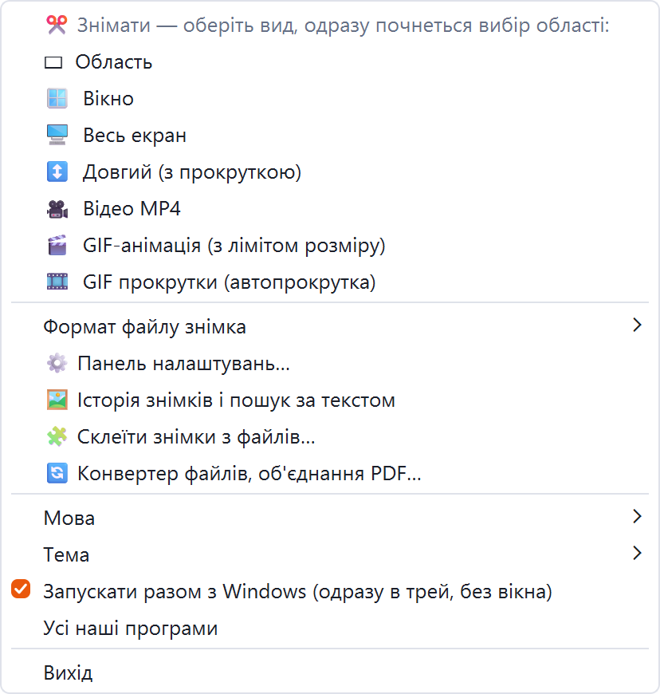

[English](README.md) · [Українська](README.uk.md) · [Русский](README.ru.md)

🌐 Усі наші програми: https://drugoj00.github.io/

Опис і скриншоти: https://drugoj00.github.io/phone-in-window-with-sound/long-scissors.html

# Довгі ножиці

Скриншоти Windows: область, вікно, екран і довга сторінка з прокруткою; запис відео та GIF; редактор, текст зі знімка, історія з пошуком.

Безкоштовна програма для Windows. Знімає область, вікно, весь екран і довгу сторінку: сторінка гортається вниз автоматично, кадри склеюються без повторів. Записує відео зі звуком і GIF з лімітом розміру. Редактор із малюванням, кроками й розмиттям, «Гарно» для рамки й тла, копіювання тексту зі знімка (OCR), історія з пошуком за текстом, склеювання й конвертер файлів. Живе в треї: клацання по значку одразу починає зйомку.

⭐ Якщо програма корисна, поставте зірку цьому репозиторію: це безкоштовно й допомагає іншим її знайти.

## Завантажити

**Версія 1.0.** [LongScissors-1.0.exe](https://github.com/drugoj00/long-scissors/releases/latest) (Assets) · [Releases](https://github.com/drugoj00/long-scissors/releases)

SHA-256: `153688d37dfc5728e6ebb0f3113bcedf377e05f126a9a2dafd5afddbb7cff41d`

## Що нового в 1.0

- Перша публічна версія: усе перелічене вище.

## Можливості

### Знімки

- Область, вікно, весь екран і довгий знімок: автопрокрутка вниз і склеювання кадрів без повторів.
- Таймер до 10 с, щоб встигнути відкрити меню чи список.
- Формати PNG, JPG, WEBP, BMP, PDF, Word, Excel; копія в буфер обміну.
- Клацання по значку в треї одразу починає зйомку; середня кнопка — вибір формату; Ctrl+Shift+S відкриває панель.

### Відео та GIF

- Запис відео MP4 зі звуком: система, мікрофон або обидва канали, вибір пристрою.
- GIF з лімітом розміру та тривалості, підбір ширини, кадрів і кольорів.
- GIF прокрутки: сторінка гортається автоматично.

### Редактор

- Перо, маркер, лінія, стрілка, рамка, овал, текст, номери, кроки з підписом, розмиття, обрізка.
- «Гарно»: рамка вікна або телефона, тінь, тло.
- Копіювання тексту зі знімка (OCR Windows), таблиці — у Word і Excel.

### Файли та історія

- Історія знімків із пошуком за текстом на них.
- Склеювання довгого знімка з готових картинок або PDF.
- Конвертер: картинки, PDF, Word, Excel, текст; об’єднання файлів в один PDF.

### Решта

- Значок біля годинника, автозапуск без вікна, одна копія програми.
- Російська, українська, англійська; світла й темна тема.

## Скриншоти

## Вимоги

Windows 10 або 11 (64-біт). Права адміністратора не обов’язкові. Копіювання тексту використовує розпізнавання Windows (російська мова має бути встановлена); інтернет не потрібен.

## Швидкий старт

1. Завантажте LongScissors-1.0.exe і запустіть; Windows запитає дозвіл (при відмові програма стане в теку користувача).
2. Програма живе в треї біля годинника: клацання по значку — одразу вибір області; права кнопка — усі режими, формат, мова, тема.
3. Ctrl+Shift+S відкриває панель із налаштуваннями: що знімати, таймер, формат, тека.
4. Знімок відкривається в редакторі: малюйте, копіюйте, зберігайте.

## Обмеження

- Довгий знімок гортає сторінку колесом миші й рухає курсор: під час зйомки мишею краще не користуватися.
- Копіювання тексту спирається на розпізнавання Windows: українські «і», «ї», «є» іноді губляться.
- Запис звуку системи й мікрофона йде окремо та поєднується за годинником; можливий невеликий зсув.
- Перевірено на Windows 11; на Windows 10 запис екрана та звуку окремо не перевірявся.
- Інсталятор не підписаний сертифікатом видавця: Windows може показати попередження SmartScreen («Докладніше» → «Все одно виконати»).
- Всередині ffmpeg, ліцензія LGPL/GPL.
